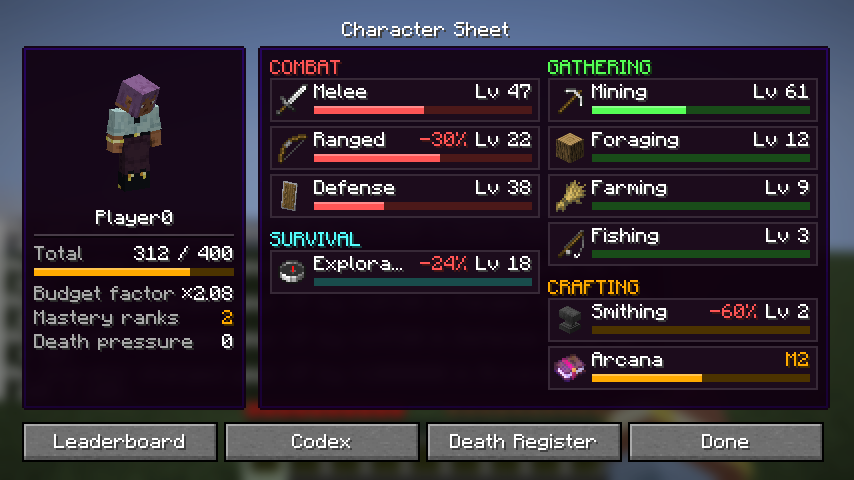

# Extreme Progression

*A hardcore RPG progression overhaul for Minecraft 26.3 on Fabric.*

Eleven playstyle skills, each with its own skill tree, three specializations and a Mastery layer. Synergies between skills
that you discover yourself. Slow, meaningful progression, and deaths that cost you for real, always shown up front.



- **Eleven skills**: Melee, Ranged, Defense, Mining, Foraging, Farming, Fishing, Exploration, Smithing, Arcana and
  Trading, earned by playing, with rules against farms and AFK.
- **Trees**: a trunk of four bonuses per skill, and thirty-three specializations with an ability, passives, a choice and
  a price each.
- **Mastery** past level 100, ten ranks with a perk each.
- **Thirteen hidden synergies**, a personal Codex and the server's Chronicle.
- **Playing together**: parties with an XP bonus for members near who play too, and eight duo synergies you discover
  with a party member.
- **Deaths that cost you**: death pressure, the dimensions' factors, death fatigue, the Death Register and At Stake.
- **For server owners**: presets, data files for every number, an in-game settings screen, XP events, a leaderboard and
  admin commands, and placeholders for TAB and Styled Chat ([server/README.md](server/README.md)).

More: the page text in [docs/modrinth/description.md](docs/modrinth/description.md), the full design in
[docs/DESIGN.md](docs/DESIGN.md), what changed in [CHANGELOG.md](CHANGELOG.md), and how to try it in
[docs/TESTING.md](docs/TESTING.md). Works on its own, and together with
[Extreme Dimensions](https://github.com/Peertjeh/extremedimensions).

## For admins: the Players screen and permissions

`/skills players` (or the **Players** button at the top of the Character Sheet) opens the Players screen: every player
the world knows, online first and then offline, with a search box. For the one picked: their total, Mastery, deaths,
death pressure and fatigue, party and synergies, and every skill with a level taken off or put on (Shift: ten; at the
maximum level a Mastery rank), a free respec, **Abilities ready**, **Clear deaths**, and for who may reset, a reset of a
skill or of everything (press twice). It works for players offline too (their file is written at once); the server
checks every request, writes every change to its log, and tells a player online what changed.

### Permissions (LuckPerms)

Every admin command and screen asks a permission of its own, through Fabric API's permission API, so a permission mod
such as LuckPerms can hand one out without making someone an operator (a moderator who may change levels but not
reset anyone, say). Without a permission mod each falls back to the operator level it always needed, so nothing
changes on a server that has none; in a world of your own you hold them all.

| Permission | Opens | Without a permission mod |
|---|---|---|
| `extremeprogression.admin.players` | The Players screen, `/skills players`, `/skills inspect`, `/skills admin set\|add\|respec\|cooldowns` | Operator level 2 |
| `extremeprogression.admin.reset` | Reset in the Players screen, `/skills admin reset` | Operator level 3 |
| `extremeprogression.admin.settings` | Changing the settings (the settings screen), `/skills settings`, `/skills preset`, `/skills reload` | Operator level 3 |
| `extremeprogression.admin.events` | XP events: `/skills xprate` | Operator level 3 |

In LuckPerms: `/lp group moderator permission set extremeprogression.admin.players true`. (Under the hood each is an id
such as `extremeprogression:admin/players`; LuckPerms writes it with dots.) The fallback levels are fixed on purpose:
who may change the settings cannot lower the bar for a permission they lack. Extreme Dimensions works the same way.

## Requirements

- Minecraft **26.3**, Fabric Loader **0.19.5+**, Fabric API **0.162.0+**, Java **25**.
- The mod goes on the server **and** on every client.

## Building

```
./gradlew build
```

This also runs the server game tests. The client test runs with `./gradlew runClientGameTest` and saves screenshots
under `build/run/clientGameTest/screenshots/`. CI runs both on every push, and a compatibility run with Extreme
Dimensions, Sodium, Iris and Mod Menu. A new version in `gradle.properties` is released by CI once all three pass.

## License

[MIT](LICENSE).
